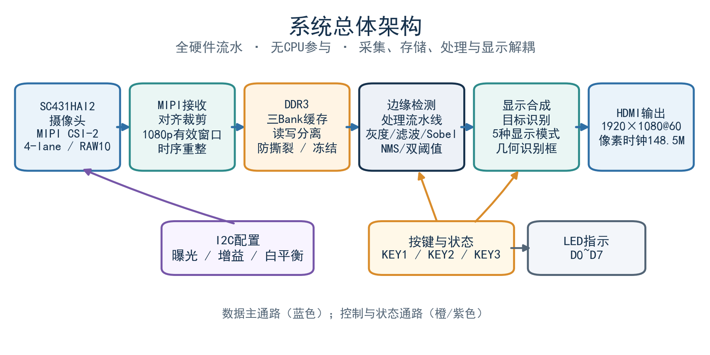
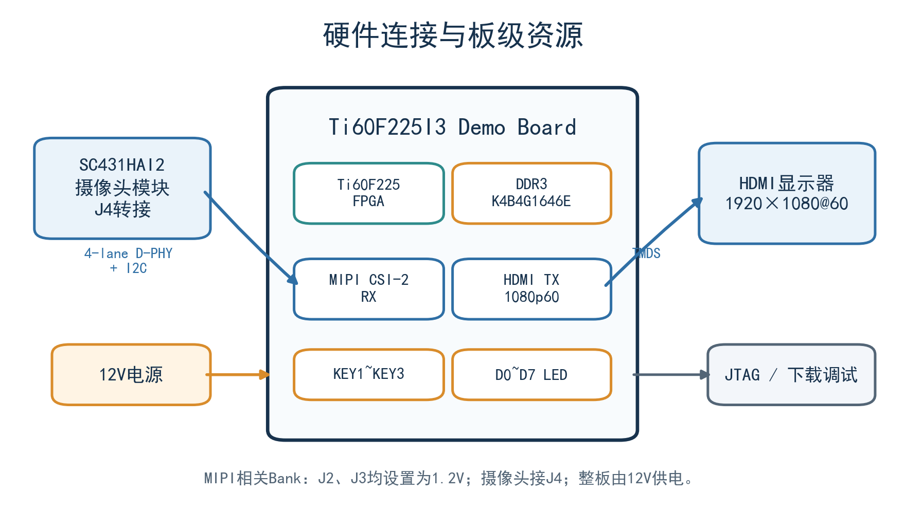

# Ti60F225 实时图像处理与形状识别系统

基于 **Efinix Titanium Ti60F225I3**、**SC431HAI2** 图像传感器和纯 RTL 数据通路的实时
视觉系统。从 4-lane MIPI CSI-2 采集 1920×1080 RAW10，经 DDR3 帧缓存后完成去马赛克、
**自适应白平衡 + 自动曝光**、灰度化、滤波、Sobel/Canny 边缘检测、HDMI 输出，以及
**基于墨迹分割 + 填充率的圆/矩形/三角形识别**。



## 这一版改了什么

| 问题 | 旧实现 | 本版 |
| --- | --- | --- |
| 白天偏红、夜间正常、手动白平衡无效 | 编译期固定增益 R=1.5625×/B=1.8125×，8bit 削顶，手动窗口下限仍 1.3125× | 逐帧闭环自适应白平衡（近中性像素 + 灰度世界两段式），增益 0.5~2.0×，手动 0.375~2.25× |
| 曝光工作点固定 | 固定 4.813× 模拟增益 + 固定曝光 | 轻量 AE：先调曝光后调增益，带死区与稳定等待 |
| 形状识别对线宽/光照/角度敏感 | 固定半径 Hough + 固定行程 + 5 种长宽比假设 | 局部均值墨迹分割 + 连通域填充率 + 两个阈值 |

详见 [白平衡与曝光](docs/white-balance.md)、[识别算法](docs/recognition.md)。

## 硬件平台

| 项目 | 配置 |
| --- | --- |
| FPGA | Efinix Ti60F225I3（Titanium 家族，Ti60F225A_V4 Demo Board） |
| 摄像头 | SC431HAI2，接 J4 转接板，4-lane MIPI CSI-2，RAW10 |
| 摄像头 I²C | SCL=GPIOR_20，SDA=GPIOR_18（板上 4.7 kΩ 上拉至 3V3），RST=GPIOR_16，地址 0x30 |
| MIPI Bank | J2、J3 均为 1.2 V |
| 帧缓存 | 板载 DDR3 K4B4G1646E，三 Bank 乒乓 |
| 显示 | HDMI 1920×1080@60，像素时钟 148.5 MHz |
| 按键 / 指示灯 | KEY1=GPIOR_22，KEY2=GPIOR_21，KEY3=GPIOL_03；D0~D7 |
| 电源 | 12 V DC |



## 数据通路

```text
MIPI RAW10 (4 lane)
  -> sensor_clipper      1081x640 -> 1080x480 有效窗口裁剪
  -> DDR3 三 Bank        帧缓存 / 冻结
  -> rgb_gain_v1         白平衡增益(Q8.8，来自 cam_ae_awb)
  -> raw_to_rgb          BGGR 去马赛克
  -> cam_ae_awb          统计 -> 增益/曝光闭环
  -> edge_proc           灰度 -> 中值/高斯 -> Sobel -> NMS -> 双阈值滞回
  -> shape_ink           4x4 -> 局部均值墨迹掩码 -> 连通域 -> 填充率分类
  -> HDMI 1920x1080@60
```

## 目录结构

```text
rtl/
  ti60f225_oob_top.v        顶层、时钟/复位、按键、显示链路
  cam_ae_awb.v              自适应白平衡 + 自动曝光           [本版新增]
  sensor_clipper.v          SC431HAI2 有效窗口裁剪
  edge/edge_proc.v          灰度、滤波、Sobel/Canny、显示合成
  edge/shape_ink.v          墨迹分割 + 连通域填充率识别        [本版新增]
  debayer/                  RAW -> RGB 与 Q8.8 增益
  frame_buffer_V4/          DDR3 帧缓存与 Bank 切换
  ddr3_controller/          DDR3 控制器
  dvi_tx/                   HDMI/TMDS 发送
  cam_i2c_ctrl/             摄像头 I2C 初始化与运行时曝光/增益调度
ip/                         摄像头与显示 IP
sim/                        Icarus Verilog 仿真
  tb/                       测试平台
  run_sim.ps1               回归入口
build/                      Efinity 编译与 JTAG 烧录脚本
docs/                       设计说明
tools/verify_ink.py         用实拍照片复现识别算法并可视化
tools/recog_study.py        早期算法对比研究（决策树/CNN 对照）
ti60f225_oob.xml            Efinity 工程
ti60f225_oob.peri.xml       管脚与接口约束
ti60f225_oob.sdc            时序约束
```

## 按键

| 输入 | 功能 |
| --- | --- |
| KEY1 短按 / 长按 | 阈值档位 +1 / 边缘颜色循环 |
| KEY2 短按 / 长按 | 阈值档位 -1 / DDR3 画面冻结 |
| KEY3 短按 / 长按 | 滤波模式循环 / 显示模式循环 |
| KEY1+KEY2 | 进入 / 退出摄像头调节模式（进入后 AE 与 AWB 均冻结） |
| KEY1+KEY3 | 调节模式内：曝光/增益页 ↔ 白平衡页 |
| KEY3 长按 | 退出调节模式 |

白平衡页里 KEY1 长/短按调 R，KEY2 长/短按调 B，范围 0.375×~2.25×，每档 0.125×；
KEY3 短按恢复默认并交还给自动白平衡。

## 仿真

需要 Icarus Verilog 12 与 Python 3（PPM 转 PNG）。

```powershell
cd sim
.\run_sim.ps1 -Test all -Strict      # 全量快速回归
.\run_sim.ps1 -Test awb              # 白平衡/AE 闭环
.\run_sim.ps1 -Test shape            # 旧识别器(决策树)四类回归
.\run_sim.ps1 -Test ink              # 墨迹识别器四类回归
```

当前结果：

| 用例 | 结果 |
| --- | --- |
| `tb_edge_proc` / `tb_edge_chain` / `tb_debayer_bg` / `tb_sensor_clipper` / `tb_gamma_correction` / `tb_cam_cfg_sched` | PASS |
| `tb_cam_ae_awb`（白天/夜间/切回/手动/AE） | PASS |
| `tb_shape_ink`（圆/矩形/三角形/空白，墨迹分割） | 4/4 PASS |
| `tb_shape_rec`（旧的决策树识别器） | 4/4 PASS |

## Efinity 编译与烧录

```powershell
$env:EFINITY_HOME = 'C:\Efinity\2026.1'
.\build\build_all.bat
.\build\flash_jtag.bat
```

> 本版关闭了在线调试（`enable-mark-debug=0`），bitstream 不含 debug hub，
> 资源占用更低；需要在线抓信号时把该选项改回 1 并恢复 `debug_profile.wizard.json`。

## 资源占用

以 `outflow/ti60f225_oob.res.csv` 为准（每次编译后自动更新）。本次编译结果见
`docs/release-v10.md`。

## 验证范围与已知边界

- 白平衡闭环在仿真里对暖光/冷光均能把三通道偏差压到 7% 以内（死区 6.25%）；
- 形状识别在 14 张实拍照片上框出 30+ 个图形，填充率与理论值吻合（圆 0.79 / 方 0.95 / 三角 0.52）；
- 识别对旋转不敏感（填充率是形状不变量），要求外接框 ≥ 14×14 采样点、轮廓基本闭合；
- 以上均为仿真结论，实板验证需要按板卡实际光照与靶纸复测。

## 许可

原创代码采用 [MIT License](LICENSE)。Efinix/Elitestek/OpenCores 生成的 IP、厂商工具
文件与测试图片仍适用其原始许可，详见 [THIRD_PARTY_NOTICES.md](THIRD_PARTY_NOTICES.md)。
