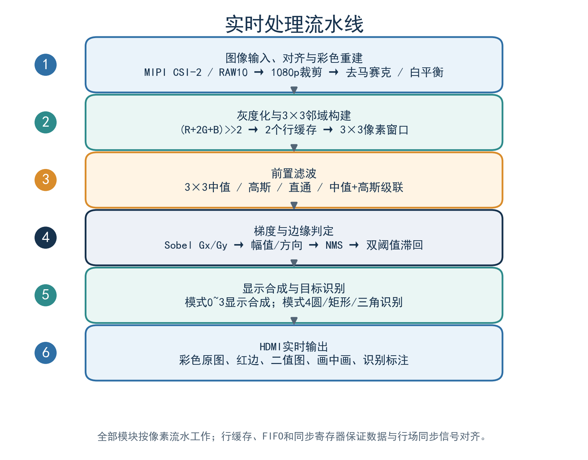

# Ti60F225 实时图像边缘检测系统

基于 **Efinix Titanium Ti60F225I3**、**SC431HAI2** 图像传感器和纯 RTL 数据通路的实时图像处理工程。系统从 MIPI CSI-2 摄像头采集 1920×1080 RAW10 视频，经 DDR3 三 Bank 帧缓存后完成灰度化、滤波、Sobel/Canny 边缘检测、彩色边缘叠加、HDMI 输出，并支持圆形/椭圆、矩形/正方形、三角形/旋转三角形的几何识别。


## 主要功能

- 4-lane MIPI CSI-2、RAW10 输入，SC431HAI2 有效窗口对齐与裁剪。
- 1920×1080@60 HDMI 输出，三 Bank DDR3 帧缓存，支持画面冻结。
- 3×3 中值、Gaussian、直通、中值+Gaussian 级联滤波。
- Sobel 梯度、22.5° 方向分带、1/2 插值 NMS、双阈值滞回。
- 五种显示模式：分屏、彩色原图+红边、二值边缘、画中画、目标识别。
- 圆形/椭圆、矩形/正方形、三角形/旋转三角形识别，带外接框与中文标签。
- KEY1/KEY2/KEY3 组合按键调节阈值、滤波、显示模式、曝光、增益和白平衡。
- 无 CPU、无外部上位机，处理链路全部由 RTL 完成。

## 硬件平台

| 项目 | 配置 |
| --- | --- |
| FPGA | Efinix Ti60F225I3，Ti60F225A_V4 Demo Board |
| 摄像头 | SC431HAI2，J4 转接板，4-lane MIPI CSI-2，RAW10 |
| 帧缓存 | 板载 DDR3 K4B4G1646E，三 Bank 乒乓 |
| 显示 | HDMI 1920×1080@60，像素时钟 148.5 MHz |
| MIPI Bank | J2、J3 均为 1.2 V |
| 电源 | 12 V DC |


## 目录结构

```text
rtl/                         FPGA RTL 与应用逻辑
  ti60f225_oob_top.v         顶层、时钟/复位、摄像头和显示连接
  edge/edge_proc.v           灰度、滤波、Sobel/Canny、显示合成、识别
  sensor_clipper.v           SC431HAI2 有效窗口裁剪
  debayer/                   RAW 到 RGB 重建
  frame_buffer_V4/           DDR3 帧缓存与 Bank 切换
  ddr3_controller/           DDR3 控制器
  dvi_tx/                    HDMI/TMDS 发送
  cam_i2c_ctrl/              摄像头 I2C 配置
ip/                          摄像头与显示 IP 配置
sim/                         Icarus Verilog 仿真
  tb/                        测试平台
  images/                    仿真图片、边缘/方向激励
  run_sim.ps1                全量或单项仿真入口
build/                       Efinity 编译与 JTAG 烧录脚本
docs/                        设计报告和架构图
ti60f225_oob.xml             Efinity 工程
ti60f225_oob.peri.xml        管脚与接口约束
ti60f225_oob.sdc             时序约束
```

## 算法流水线

```text
MIPI RAW10
  -> 有效窗口裁剪/对齐
  -> DDR3 三 Bank 帧缓存
  -> RAW 去马赛克、白平衡、灰度化
  -> 3x3 行缓存
  -> 中值 / Gaussian / 直通 / 级联滤波
  -> Sobel Gx/Gy、幅值与方向
  -> NMS
  -> 双阈值滞回与弱边缘连接
  -> 显示合成 / 几何识别
  -> HDMI 1920x1080@60
```



## 按键与指示灯

| 输入 | 功能 |
| --- | --- |
| KEY1 短按 / 长按 | 阈值档位 +1 / 边缘颜色循环 |
| KEY2 短按 / 长按 | 阈值档位 -1 / DDR3 画面冻结与解冻 |
| KEY3 短按 / 长按 | 滤波模式循环 / 显示模式循环 |
| KEY1+KEY2 | 进入或退出摄像头调节模式 |
| KEY1+KEY3（调节模式内） | 切换曝光/增益页与白平衡页 |
| KEY3 长按（调节模式内） | 退出摄像头调节模式 |
| D2 / D3 | 识别状态或显示模式状态 / 冻结指示 |
| D4–D7 | 阈值档位或参数档位 |

## 仿真

需要 Windows PowerShell、Icarus Verilog 12 和 Python 3（用于 PPM 转 PNG）。将 Icarus Verilog 加入 `PATH`，或设置 `IVERILOG` 环境变量指向 `iverilog.exe`。

```powershell
cd sim
.\run_sim.ps1 -Test all -Strict
```

单项回归示例：

```powershell
.\run_sim.ps1 -Test edge
.\run_sim.ps1 -Test chain
.\run_sim.ps1 -Test roi -Strict
.\run_sim.ps1 -Test scale -Strict
.\run_photo_tests.ps1
.\run_web_tests.ps1
```

仿真输出位于 `sim/out/`，VCD 位于 `sim/wave/`，两者均不进入版本库。

## Efinity 编译与烧录

安装 **Efinity 2026.1**，并确保 `efx_run.bat`、`efx_run_map.py`、`efx_run_pnr.py` 等工具在 `PATH` 中，或设置 `EFINITY_HOME`：

```powershell
$env:EFINITY_HOME = 'C:\Efinity\2026.1'
.\build\build_all.bat
.\build\flash_jtag.bat
```

编译产物写入 `outflow/`，JTAG 烧录使用板载 FTDI。不同板卡版本必须先核对 `ti60f225_oob.peri.xml` 中的引脚和 Bank 电压。

## 资源占用

| 资源 | 数量 |
| --- | ---: |
| LUT4 | 21,596 |
| FF | 11,823 |
| SRL8 | 1,303 |
| RAM10 | 157 |
| DPRAM10 | 4 |
| DSP48 | 4 |

以上为 v8.12 的 Efinity 最终报告数据，具体数值可能随工具版本和约束变化。

## 文档

- [v8.12 版本说明](docs/release-v8.12.md)

## 验证状态

已验证：

- SC431HAI2 有效窗口裁剪、去马赛克、白平衡、滤波器、Sobel、NMS、双阈值和形状识别仿真；
- 圆、矩形、三角形靶纸及加号负样本回归；
- Efinity map、interface、Pnr 和 pgm 流程；
- Ti60F225A_V4 + SC431HAI2 + HDMI 实板显示。

工程仍依赖具体板卡引脚、摄像头模组和 Efinity 版本；移植到其他板卡时应重新核对传感器节拍、MIPI Lane 映射、DDR3 参数、HDMI 时钟和 Bank 电压。

## 第三方组件与许可

本项目原创代码采用 [MIT License](LICENSE)。Efinix/Elitestek/OpenCores 生成的 IP、厂商工具文件及测试图片仍适用其原始许可，详见 [THIRD_PARTY_NOTICES.md](THIRD_PARTY_NOTICES.md)。

